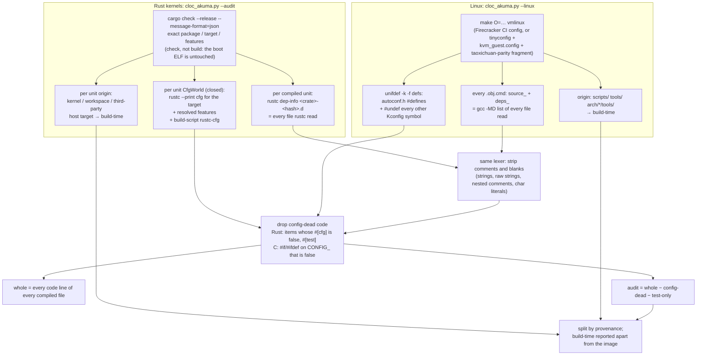

# Audit surface: how many lines must a reviewer read to trust a KVM guest kernel

**Date: 2026-10-30. Tree: `rust-org-il-experiment` @ `9f1e333f` + working tree. Tools:
`scripts/cloc_akuma.py --audit`, `scripts/cloc_akuma.py --linux`, `scripts/linux_audit_surface.sh`.**

## Why we want to know this

The talk's claim ([`RUST_ORG_IL_TALK.md`](RUST_ORG_IL_TALK.md)) is that your own software stack
can now be built by open models on an open-source base, and the minimal-kernel experiment
([`MINIMAL_SELF_HOSTING_EXPERIMENT.md`](MINIMAL_SELF_HOSTING_EXPERIMENT.md)) tests the strong
form of it: a kernel *composed* from host-tested crates, one constraint at a time, until it boots
under KVM and builds itself. If code becomes cheap to produce, the cost moves to whoever has to
**trust** it, and trust is paid for by review. So the useful measure is not how big the repo is
but how many lines go into the image a guest boots. That is what someone has to read before they
can vouch for it.

Four questions depend on that number, and each needs it measured the same way for every kernel:

1. **Does composition pay?** The experiment's premise is that you only pay for the crates you
   pull. That holds only if the count follows what the compiler actually builds, rather than
   which directories exist. `taoxichuan` vs `akuma-amd64` is the measurement: same crate pool,
   one kernel composed to a single constraint, the other carrying everything.
2. **What does Linux cost for the same job?** A guest has to trust its own kernel *and* the host
   that runs it, so the unit is a **stack**: the host kernel (with its hypervisor) plus the guest
   kernel. Akuma's stack is `akuma-amd64` (the KVM host, hypervisor and device models in-kernel)
   plus taoxichuan; Linux's is a KVM-enabled Linux host plus a Linux guest, plus a userspace VMM
   (Firecracker), which this tool does not count yet. Linux has its own composition tool
   (Kconfig), so the fair comparison is Linux *configured* for the same job, measured with the
   same rules.
3. **Whose code is it?** Code generated by a model and checked into the tree, crates.io code,
   and the kernel's own glue are different review problems. The count is split by provenance:
   the kernel crate itself, workspace crates, third-party crates.
4. **Where does the compiler stop checking?** Lines inside `unsafe` are where Rust's guarantees
   become the reviewer's job. Linux has no such boundary: every line carries the same
   obligation. The `unsafe` column is therefore the part of the Rust audit that is like auditing C.

The number is a *surface*, not a risk score. Linux's lines have had decades of review by many
people; a line written last week by an agent has had one. What lines measure is how much reading
you sign up for, which is the variable composition and open models actually change.

## Definition

An **auditable line** is a line that is:

- **code** — not a comment, not blank (a reviewer reads comments, but they cannot be wrong in a
  way the machine executes);
- **in a file the compiler read** for the exact package, target and feature set that produces
  the image — not merely present in a linked crate's directory;
- **live under that build's configuration** — not inside an item whose `#[cfg]` (Rust) or
  `#if CONFIG_*` (C) is false for this build, and not test-only (`#[test]`, `#[cfg(test)]`);
- **in the runtime image** — code that runs on the build host (proc-macros, build scripts and
  their dependencies; Kbuild's host programs) is reported separately as *build-time*. It shapes
  the image and belongs to the supply chain, but it never runs in the guest.

## Method



### Rust (`--audit`)

1. **Files from the compiler.** `cargo check --release --message-format=json` for the kernel's
   pinned package, target and features (`AUDIT_KERNELS` in the script; `no-tests` for all of
   them — a guest image carries no boot self-tests). Every `compiler-artifact` message names the
   unit's output directory, and rustc wrote `<crate>-<hash>.d` there: the list of source files it
   read, including `#[path]` modules and `include_str!`'d assembly. A file in a linked crate's
   `src/` that no `mod` reaches under this build's cfg is not in the list and is not counted.
   `check` instead of `build`: feature resolution and dep-info are the same, and it does not
   overwrite the kernel ELF that is about to boot.
2. **Lines from the cfg the compiler saw.** Each unit gets a `CfgWorld`: the target's
   `rustc --print cfg` (plus `.cargo/config.toml` rustflags, `panic=abort`, debug assertions per
   the unit's profile), `feature="…"` for each feature cargo resolved *for that unit*, and the
   `rustc-cfg` lines its build script emitted (`build-script-executed` messages). This set is
   closed, because rustc treats a cfg it was not given as false, so every predicate evaluates to
   true or false. The scanner drops an item whose `#[cfg]` is false, and drops
   `#![cfg(false)]` files whole. An atom the parser cannot read evaluates to unknown, and the item
   is **kept**: a parse failure over-counts rather than hiding code.
3. **Provenance.** The unit whose manifest is the kernel's is *kernel*; other `path+` packages
   are *workspace*; registry and git packages are *third-party*. Units compiled for the host
   (proc-macros, build scripts, everything they depend on) are *build-time*.

### Linux (`--linux`, driven by `scripts/linux_audit_surface.sh`)

The two Rust steps map directly onto Kbuild's:

1. **Files from the compiler.** Every object Kbuild compiles leaves a `.<obj>.cmd` whose
   `source_` and `deps_` lines are gcc's `-MD` output — rustc's dep-info in make syntax. Only
   `vmlinux` is built: a PVH guest boots the ELF directly, so the bzImage real-mode setup is not in
   what runs, and neither are modules. Objects under `scripts/`, `tools/` and `arch/*/tools/` are
   Kbuild's host programs, which go in the build-time bucket. `$(wildcard include/config/…)` entries
   are Kconfig dependency stamps, not sources, and are skipped. Each header is counted once for the
   whole image, the way a Rust module is.
2. **Lines from the config the compiler saw.** `unifdef -k` resolves `#if`/`#ifdef`/`#elif` on
   `CONFIG_` symbols using a definitions file: every `#define` in the build's
   `include/generated/autoconf.h`, and an `#undef` for every other `config` symbol declared in any
   `Kconfig*` file of the tree. `IS_ENABLED(CONFIG_X)` inside a *directive* is rewritten to
   `defined(CONFIG_X)` first (no modules are built, so built-in is the same as enabled).
   `-k` also drops `#if 0`.
3. **Two configurations:**
   - `firecracker` — Firecracker's own CI guest config for the version
     (`resources/guest_configs/microvm-kernel-ci-x86_64-6.18.config`). This is Linux as people
     actually boot it in a microVM.
   - `minimal` — `tinyconfig` + `kvm_guest.config` + a fragment naming only what taoxichuan itself
     provides (virtio-mmio block and net, ext2, IPv4, AF_UNIX, 8250 serial console, ELF and script
     binfmt, futex/epoll/eventfd/membarrier, PVH). This is Linux trimmed to the same job, and so the
     floor. The script warns about any fragment line Kconfig drops.

### What changed from the earlier counts, and why the old numbers were wrong

The existing reports (`By platform`, `--external`) count **directories**: a linked workspace
crate's whole tree with tests split out, and a third-party crate's whole `src/`. Three things
inflate that:

- files that no `mod` reaches under this build — another arch's backend, a feature's module;
- items gated on another arch or an unselected feature in files that *are* compiled — smoltcp's
  IPv6, 6LoWPAN and 802.15.4 paths, or akuma-exec's `#[cfg(kernel_smp_shared)]` group-kill
  path in the single-core taoxichuan;
- every test module in every third-party crate (`--external` counted those as production code
  because only workspace files went through the test classifier's path rules).

For taoxichuan, the directory method gave 47,513 workspace + 66,329 third-party = **113,842**
lines, against **84,761** compiled-and-live, an over-count of about a third. Of the 22
third-party crates, `smoltcp` alone is 22,583 lines whole and 11,897 live.

**Scanner bug found on the way.** A `#[cfg]` on the *last* field of a struct or enum, or on the
last match arm, has no `;` and no braces of its own, so the gated span never closed and absorbed
the code after it until a `;` happened to land at the same brace depth. Under the test-only
analysis this showed up twice in the tree: `akuma-ext2`'s `#[cfg(test)] counters` field
swallowed the 30 lines after it (including the production `BlockCache` aliases), and
`akuma-net-nic`'s `#[cfg(test)] Scripted` variant swallowed the 200-line production
`impl ExternalDevice`. Gated spans now also end at their list's `,` (fields, variants, arms,
parameters) and when the enclosing bracket closes, and a `;` inside `[T; N]` no longer ends an
item. That moves 159 lines from test back to production in the ordinary report. Under `--audit`,
where kernels gate match arms on `feature` and `target_arch` all the time, the old behaviour
would have been wrong by much more.

### A stack is a union, not a sum

Two kernels built from one pool share code, and a reviewer reads a shared line once. Both modes
therefore report, for every pair of kernels (or Linux build trees), the **line-level** union and
intersection of their live lines. It is computed per line, not per file, because the same
`ext2.rs` under two feature sets, or the same `kernel/fork.c` under two configs, has two
different live sets. A Linux `.cmd` path and a rustc dep-info path both name the file, and
`unifdef -b` blanks removed lines instead of deleting them, so line numbers stay comparable
across configs of one tree.

## Results (2026-10-30)

Rust: `scripts/cloc_akuma.py --audit taoxichuan akuma-amd64 akuma-aarch64`, `--features no-tests`,
nightly-2026-09-19. Linux: `scripts/linux_audit_surface.sh {minimal,firecracker,host} 6.18`, run
natively on the ryzen's Pop!_OS (`NATIVE=1`, gcc 11, `-j8` under `nice 19`).

| kernel | audit lines | whole compiled files |
|---|---:|---:|
| **taoxichuan** (guest) | **84,761** | 127,706 |
| Linux 6.18 `minimal` guest (tinyconfig + kvm_guest + taoxichuan's features) | **836,651** | 981,911 |
| Linux 6.18 `firecracker` guest (Firecracker's CI config) | **1,868,016** | 1,978,869 |
| **akuma-amd64** (the KVM host) | **151,235** | 229,957 |
| Linux 6.18 `host` (x86_64_defconfig + KVM, TUN, vhost-net built in) | **2,362,283** | 2,520,657 |

| stack (host + guest, line-level union) | audit lines |
|---|---:|
| **akuma-amd64 + taoxichuan** | **158,909** |
| Linux host + `minimal` guest | **2,391,510** |
| Linux host + `firecracker` guest | **2,861,309** (+ the Firecracker VMM, not counted) |

- The guest: Linux trimmed to taoxichuan's job is **9.9x** taoxichuan; Linux as Firecracker
  ships it is **22x**.
- The stack: **15x** with the minimal Linux guest, **18x** with Firecracker's, before the VMM.
- Linux's minimal guest spends 136,437 audit lines on `include/linux` headers alone and 103,501 on
  `arch/x86` - each more than taoxichuan's whole image.
- `#if CONFIG_` resolution removes 15% of the minimal guest's compiled lines and 5-6% of the
  firecracker and host builds, against a third for the Rust kernels' `#[cfg]`: Linux's
  per-config pruning happens mostly at the file level (Kbuild), Rust's mostly inside files.
- The Linux host + firecracker union shares 1,368,990 lines; Akuma's shares 77,090.
- **None of the Akuma kernels has been audited, taoxichuan included.** Its numbers are the size of
  the reading an audit would take, not a claim that the reading was done; Linux's lines have had
  decades of it.
- Build-time host code: Linux 22-25k lines (Kbuild's host programs) against 31.7-50.8k for the
  Rust kernels (proc-macros, `syn` above all).

### Stacks (Rust, line-level union)

| pair | union | shared | union `unsafe` | shared `unsafe` |
|---|---:|---:|---:|---:|
| akuma-amd64 + taoxichuan | 158,909 | 77,090 | 3,715 | 2,603 |
| akuma-aarch64 + taoxichuan | 116,101 | 72,452 | 3,473 | 2,345 |
| akuma-amd64 + akuma-aarch64 | 164,486 | 90,538 | 4,156 | 2,356 |

taoxichuan on an Akuma host adds 7,674 lines to the host's 151,235: 91% of its live lines are
already live in the host, all 41,748 third-party lines among them.

### Per-kernel breakdown (Rust)

| | taoxichuan | akuma-amd64 | akuma-aarch64 |
|---|---:|---:|---:|
| kernel crate | 6,652 | 26,619 | 80 |
| workspace crates | 36,361 (54) | 74,535 (91) | 58,918 (68) |
| third-party crates | 41,748 (22) | 50,081 (27) | 44,791 (23) |
| **runtime image** | **84,761** | **151,235** | **103,789** |
| of which inside `unsafe` | 2,812 | 3,506 | 3,006 |
| whole compiled files (no cfg evaluation) | 127,706 | 229,957 | 149,411 |
| build-time (host) | 31,743 | 50,756 | 32,059 |

Third-party code is about half of taoxichuan's image (41.7k of 84.8k), and two thirds of its
`unsafe` lines (1,872 of 2,812): `zerocopy`, `heapless`, `lock_api`, `virtio-drivers`. The
largest single crate in the image is `smoltcp` (11,897), which is bigger than the kernel crate
itself. The aarch64 kernel crate is 80 lines because `src/` is a composition root, and its
dispatch lives in `akuma-syscalls-glue` (11,894).

## What this does not count, and which way each gap leans

- **`cfg!()` and `IS_ENABLED()` in expressions** are kept on both sides. Both branches are
  compiled and type-checked; the optimizer drops one. This leans toward over-counting, and does
  so symmetrically.
- **Code the linker discards** (functions nothing calls) is counted. Dep-info is per crate,
  not per function, so this is an upper bound. `--elf` gives the opposite bound (symbol bytes per
  crate in an unstripped image) for when the gap matters.
- **Linux conditionals not on `CONFIG_`** (`__ASSEMBLY__`, compiler-version tests, `#ifdef
  MODULE`) are kept, which over-counts Linux slightly. Header content that a translation unit
  includes but never uses is counted too, as Rust's unused `pub` items are.
- **Macros** are counted where they are defined, not where they expand, on both sides. Proc-macro
  *output* is not in any file, so a `#[derive]`'s generated code is uncounted; the proc-macro's
  source is in the build-time bucket.
- **Assembly** is counted as code: `.s` files reached through `include_str!` on the Rust side,
  `.S` files on the Linux side. Inline `asm!` lines count as Rust code lines.
- **The VMM** is not counted on the Linux side yet: Firecracker (Rust, its own crate graph) or
  QEMU is userspace code on the Linux host that the guest must trust, while Akuma's VM device
  models are in `akuma-amd64` and so are counted. This flatters Linux. PVH boot means there is no
  guest firmware in the path for either.
- **Minimal-Linux parity is approximate.** The fragment is the feature list taoxichuan provides,
  not a proof that Linux under it can run the same workload; `tinyconfig` also drops things
  (e.g. `/proc`) that busybox scripts may expect. Treat `minimal` as a floor, and `firecracker`
  as what is actually deployed.
- **Lines are not effort.** A line inside `unsafe`, a lock-free path or a page-table walker costs
  more to review than a match arm in a wire decoder. The `unsafe` column is the one place this
  measure tries to separate the two.

## Reproduce

```bash
scripts/cloc_akuma.py --audit                       # taoxichuan + akuma-amd64 (~10 s, cargo check)
scripts/cloc_akuma.py --audit taoxichuan akuma-amd64 akuma-aarch64 --top 20
scripts/cloc_akuma.py --audit taoxichuan --json     # per crate: whole/code/unsafe/sites
scripts/linux_audit_surface.sh firecracker 6.18     # Docker; tree + objects in volume akuma-linux-audit
scripts/linux_audit_surface.sh minimal 6.18
scripts/linux_audit_surface.sh host 6.18            # x86_64_defconfig + KVM: the Linux host
scripts/linux_audit_surface.sh count 6.18           # no build: every tree again, plus pairwise unions
docker volume rm akuma-linux-audit                  # reclaim the ~5 GB afterwards

# On a Linux box instead of Docker (how the 2026-10-30 numbers were made, on the ryzen's Pop!_OS):
# copy scripts/cloc_akuma.py and scripts/linux_audit_surface.sh into one directory there, then
JOBS=8 NATIVE=1 LINUX_AUDIT_DIR=/root/linux-audit ./linux_audit_surface.sh minimal 6.18
```

The kernel list and their features are `AUDIT_KERNELS` in `scripts/cloc_akuma.py`. Add a row
there when a new composition root lands.

## Background

- [`MINIMAL_SELF_HOSTING_EXPERIMENT.md`](MINIMAL_SELF_HOSTING_EXPERIMENT.md) — the experiment
  this measures, and its "Measurements to take before the talk".
- [`RUST_ORG_IL_TALK.md`](RUST_ORG_IL_TALK.md) — the talk.
- [`LINE_COUNT_ANALYSIS.md`](LINE_COUNT_ANALYSIS.md),
  [`LINE_COUNT_ANALYSIS_POST_AMD64.md`](LINE_COUNT_ANALYSIS_POST_AMD64.md) — the directory-based
  counts this refines.
- [`docs/reference/crate-safety.md`](../reference/crate-safety.md) — per-crate `unsafe`, generated
  by the same script.
