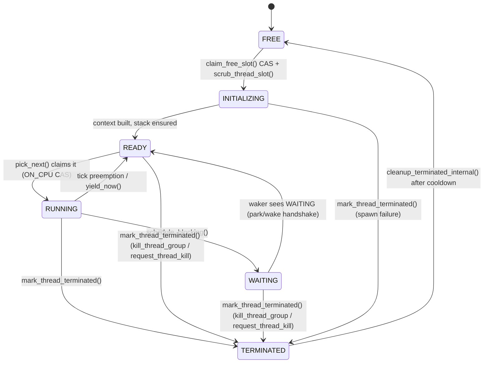

# Scheduler / threads / concurrency

Current-state architecture for preemptive threading, the scheduler, context
switch, synchronization primitives, and blocking.

> **Stability: B (verify behaviour).** One scheduler since 2026-11-11, shared by AArch64 and
> amd64 (`akuma-threading`'s `x86_*` functions, named for where they started); the AArch64
> SGI scheduler it replaced is deleted. The recurring lesson across the codebase still
> holds: **never `yield_now()` or do slow I/O inside a preemption-disabled closure**, the
> single most common cause of hangs (see `../../runbooks/debug-network.md`).

For real (shared-kernel) SMP, see [`smp-shared.md`](smp-shared.md).

## Threading model

- **Preemptive**, fixed-size thread pool. `MAX_THREADS`=256 slots (**64 under
  the `size`/`extreme-size` profile**); defined in `akuma_primitives::preempt`,
  re-exported via `threading/types.rs` and `config`. Runtime cap `THREAD_LIMIT`
  clamped to `[RESERVED_THREADS+1, MAX_THREADS]`.
- **Stacks** come from PMM (`alloc_pages_contiguous_zeroed`); per-thread sizes
  via `USER_THREAD_STACK_SIZE` / `SYSTEM_THREAD_STACK_SIZE` (`config.rs`).
  Stack-overflow detection via canaries (`ENABLE_STACK_CANARIES`).
- **Thread states** (`crates/akuma-exec/src/threading/types.rs:64`):
  `Free → Ready → Running → Terminated`. Tracked in lock-free atomics
  `THREAD_STATES: [AtomicU8; MAX_THREADS]` (`threading/mod.rs:292`; no mutex on the hot path).

### Slot state machine

`THREAD_STATES[tid]` (`crates/akuma-exec/src/threading/mod.rs:292`; the state values
themselves are the `thread_state` constants module, `types.rs:64`) is the lock-free
source of truth. `INITIALIZING` exists so the scheduler cannot pick a slot whose context
is half-built, and the `TERMINATED → FREE` edge is deliberately delayed by a cooldown so
a dying thread is never recycled while a peer still holds a reference to it.

`mark_thread_terminated()` (`threading/mod.rs:1080`, the state store itself at `:1125`) is
an **unconditional store, callable from any state** — not just `RUNNING`. `kill_thread_group`,
`request_thread_kill`, and a spawn failure all terminate a slot directly regardless of
whether it was `READY`, `WAITING`, or still `INITIALIZING`.



The `RUNNING → WAITING → READY` edge is the one with the sharp invariant — see
[Park/wake handshake](#parkwake-handshake--the-invariant). The parking thread may also
take `WAITING → RUNNING` itself, by consuming a sticky wake that arrived before it lost
the CPU.

## Preemption

- **The switch is a function call.** `yield_now` → `try_yield` → `yield_switch`
  picks, does the bookkeeping, runs the target's `switch_to` hook (TTBR0/CR3, TLS, FP
  state) and calls `akuma_switch::switch_contexts`, which saves the callee-saved registers
  and the interrupt mask on the outgoing stack and resumes the incoming one where it last
  called the same function. `try_yield` masks interrupts around the switch on both
  architectures; each thread resumes with the mask it yielded with.
- **The timer tick preempts.** AArch64: `akuma_exceptions::irq_hooked` yields on the timer
  PPI (or a scheduler SGI from a peer) when the IRQ came from EL0, or from EL1 and
  `threading::el1_preemptible()` holds. amd64: `sched::preempt_if_needed` switches ring 3
  and the idle loop, and with `ring0-preempt` kernel code outside the BKL
  (`../../archive/AMD64_RING0_PREEMPTION.md`).
- **`el1_preemptible`**: the running thread's preemption count is zero (`PreemptGuard`,
  `disable_preemption`), `POOL` is free (a spinlock that does not mask interrupts, which
  the switch takes for CPU-time accounting), and the thread is `RUNNING` (not half-way into
  a park or its own termination).
- **Tick.** 1 ms (`TIMER_INTERVAL_US`, `src/config.rs`; the host WFI probe can lengthen it),
  10 ms on `extreme-size`. **Idle cores are tickless**: an idle thread arms its core's timer
  for the earliest parked deadline or alarm (capped at 10 ms), halts, and re-arms the tick
  when it runs again (`akuma-kernel-glue`'s `hooked.rs`). No self-SGI per tick: the timer
  interrupt is itself the preemption point.
- **Preemption watchdog** (`ENABLE_PREEMPTION_WATCHDOG`, default true): warns if
  preemption is disabled >100 ms (`PREEMPTION_WATCHDOG_WARN_US`); at 5 s
  (`PREEMPTION_WATCHDOG_PANIC_US`) it prints a rate-limited `[WATCHDOG]` critical line and
  **keeps running** (`check_preemption_watchdog`, `akuma-primitives/src/preempt.rs`, never
  panics in IRQ context). This is the tripwire for the "yield inside a critical section"
  bug class.
- `with_irqs_disabled` is the primitive; nesting is counted.

## Context switch

- **What moves.** `akuma_switch::Context` per slot: callee-saved registers, `sp`, the
  interrupt mask (`DAIF`/`RFLAGS`), and on AArch64 d8-d15. Everything else is the target's
  `switch_to` hook: the address-space root, the thread's TLS register, the exception stack,
  FP state on amd64.
- **The BKL travels with the core.** A thread switches holding the lock (`yield-takes-bkl`
  on AArch64 takes it for the switch when the caller dropped it); the incoming thread
  resumes holding it and releases it on its own way back to user mode.
- **`ON_CPU` is the claim.** The picker takes a thread with a 0→1 compare-and-swap on its
  `ON_CPU` gate, so two cores never resume one stack. The outgoing thread's gate stays set
  through the switch and is cleared once its stack is provably dead
  (`rust_switch_finished`, right after the switch returns on the incoming stack).
- **Same address space, no flush.** `switch_to` returns early when the incoming root equals
  the live one. A cross-space switch publishes the new root to the per-core `ACTIVE_L0`
  registry (`mmu::publish_l0_begin`/`_end`) before installing it, which is what the
  page-table free gate (`mmu::any_core_on_l0`) reads; an unpublished root lets a dead
  address space be freed under a live `TTBR0`
  (`../../archive/HOOKED_EL1_PREEMPTION.md`). All address spaces share ASID 0, so a
  cross-space switch flushes the local TLB.

## `POOL`

`POOL: Spinlock<ThreadPool>` guards the slot table's non-atomic fields: per-slot stacks and
CPU-time stamps. The state machine itself is the lock-free `THREAD_STATES`, and the pick is
the `ON_CPU` CAS, so the switch does not hold `POOL` across the context switch; it takes it
only for the CPU-time bill. `POOL` does not mask interrupts, so `el1_preemptible` refuses a
tick that lands while it is held (the switch would spin on this core's own hold).

## Scheduling

- **Round-robin from the current slot** (`pick_next`): the first `READY` or `RUNNING`
  slot after the caller's that is not on a CPU and that this core may run. No weights, no
  priorities.
- **Pinning** is the target's `can_run` hook: the boot thread runs on the boot core, each
  idle thread on its own core.
- **Wake pass.** Before each pick, `wake_pass` readies every `WAITING` thread whose
  deadline has passed (CAS, so a racing wake or kill wins).
- **Idle threads** halt only when `runnable_exists()` finds nothing; a wake that lands
  between the last pick and the halt announcement is seen there.

## Synchronization primitives

| Primitive | Where | Use |
|---|---|---|
| `with_irqs_disabled(f)` | `runtime.rs:256`, `irq.rs:46` | The base. Disables preemption for a critical section. Nesting counted. |
| `Spinlock<T>` (`spinning_top`) | everywhere | Kernel locks. Always held briefly; IRQs may or may not be disabled — combine with `with_irqs_disabled` if the holder can be interrupted. |
| `with_device(f)` | `src/block.rs:294` | Block-device critical section — **disables preemption before acquiring the spinlock** (the priority-inversion fix). |
| `with_fs` / `with_network` / `with_socket_handle` / `with_table` | syscall/net layers | VFS/network/socket-table critical sections. Same rule: disable preemption, **never `yield_now()` or do slow I/O inside**. |

### The load-bearing rule

> A preemption-disabled closure (`with_fs`, `with_network`,
> `with_socket_handle`) must not `yield_now()`, `schedule_blocking()`, or call
> slow synchronous I/O. If you must, snapshot state, drop the closure, then
> yield/block. Violating this is the #1 cause of whole-system hangs.

## Blocking & wait/wake

- **`yield_now()`** — voluntary switch through the hooked path above; the thread stays
  `READY`. Use inside `block_on` and any cooperative loop.
- **`schedule_blocking(wake_time_us)`** — publishes `WAITING` and switches away; a waker or
  the deadline (`wake_pass`) readies it. A wake for a thread on a halted core sends that
  core a scheduler SGI.
- **`Waker`** (`ThreadWaker`, `threading/mod.rs:3351`, `wake()` at `:3363`) — `wake()` sets the sticky
  `WOKEN_STATES` flag + `PREEMPT_WAKE_TID`. Used by wait queues, epoll, and the
  SSH `current_thread_waker()`.
- **Wait queues** (see `archive/WAIT_QUEUES.md`): a thread registers a `Waker`
  on a wait queue, then `schedule_blocking()`. The producer fires the waker.
  Classic blocking-syscall pattern (pipes, poll, read on a fd).

### Park/wake handshake — the invariant

`WOKEN_STATES` is read in exactly **one** place, `schedule_blocking`. No part of
the scheduler ever reconsiders a `Waiting` thread on account of it. That makes
the following the load-bearing rule of the whole blocking layer:

> A thread must never become `Waiting` *and lose the CPU* without having checked
> the sticky flag at least once after publishing that state.

The two sides fit together only in this order:

| parking thread | waker (any core, or an IRQ on this one) |
|---|---|
| 1. store `WAITING` | a. store `WOKEN_STATES[tid] = true` |
| 2. take `WOKEN_STATES[tid]`; if set, undo `WAITING` and return | b. **if** state is `WAITING`, store `READY` + ring the scheduler |

Steps 1 and 2 are a unit: `publish_waiting_and_take_pending_wake` runs them under
a local IRQ mask, because a context switch on this core can only arrive via IRQ.
Split them and the wake is lost outright — the waker at (b) sees `RUNNING`, so it
leaves nothing behind but a flag nobody will read again, and an untimed waiter
sleeps forever. `schedule_blocking` switches out immediately after step 1, so "the park
loop rechecks the flag eventually" is **not** a substitute; the loop usually first runs
only after the thread has been resumed.

Both `SeqCst` orderings are required, not decorative: they are what guarantees
that if (a) lands after step 2's swap, then step 1's store precedes it, so (b)
observes `WAITING` and does the transition itself.

This is not hypothetical — it is the `-j4` self-host wedge, which cost several
sessions inside the futex layer before being found in the scheduler. Diagnosis
and the `hist=...EpW` signature: `../../runbooks/debug-futex-lost-wakeup.md` §4a.
Regression test: `park_wake_race_tests`
(`crates/akuma-exec/src/threading/mod.rs`).

## Evaluating a placement policy before building it

`crates/akuma-scheduler` (host-only, **not** in `default-members`) models this
scheduler against a barrier-synchronous workload and scores candidate placement
policies in about a second, instead of a kernel build + devbox boot + llama
sweep per candidate:

```bash
HOST=$(rustc -vV | grep '^host:' | cut -d' ' -f2)
cargo run -p akuma-scheduler --release --target $HOST
```

It carries `RoundRobin`, `Immunity` (the deleted SGI scheduler's bounded displacement
bypass), `Spread` (a placement governor) and `Pinned` (hard
affinity), plus the netpoll wake policy as a separate axis. **Three conclusions
from it are load-bearing for anyone about to change this file**
(`../../archive/AKUMA_SCHEDULING_EXTRACTION.md`):

- **Per-core run queues and hard affinity are not indicated.** A single global
  queue reaches 99.8% of the work-conservation bound once netpoll's wake rate
  is fixed; the queue structure was never the constraint. Affinity scores the
  same as today and hides a netpoll starvation bug.
- **`-t 4`'s collapse is wake latency, not oversubscription.** 5 runnable
  threads on 4 cores costs ~10-15%; reproducing the measured 14.6x needs a
  2-3 ms futex wake latency, which `CROSS_CORE_THREAD_COLLAPSE.md` §2
  independently measured. So the remaining win is in the explicit-wake path
  above, not in the placement scan.
- **Score throughput and latency together.** The first spread-governor variant
  "won" +14% purely by starving netpoll, and only packet latency exposed it.
  A single global starvation bound cannot serve both a barrier thread (2 ms =
  one barrier) and a packet (2 ms = a stalled ACK) — a latency class is needed.

Self-tuning knobs in this subsystem should be built on `akuma-kacho`
(`Latch` / `hysteresis` / `ramp` / `rate_per_sec`) rather than hand-rolled;
that crate exists because three subsystems each rolled the same thing.

## Real (shared-kernel) SMP

One shared kernel across all cores under real cross-core locks — see
[`smp-shared.md`](smp-shared.md) for bring-up, the shared run queue, and the
BKL carve-outs.

## Background

- `archive/MULTITASKING.md`, `archive/CONCURRENCY.md`, `archive/LOCK_REFERENCE.md`.
- `archive/WAIT_QUEUES.md`, `archive/SYSCALL_BLOCKING.md`.
- `archive/CONTEXT_SWITCH_FIX.md`, `archive/TTBR0_AND_THREADING_FIXES.md`.
- `archive/CROSS_CORE_THREAD_COLLAPSE.md` — the 2026-08-19 fixes above.
- `archive/AKUMA_SCHEDULING_EXTRACTION.md` — `crates/akuma-scheduler` (policy
  simulator) and `crates/akuma-kacho` (the shared self-tuning primitives).
- `archive/AKUMA_MULTIARCH_ATTEMPT_0.md` — the scheduler unification: the hooked scheduler
  on AArch64, its EL1 preemption (`archive/HOOKED_EL1_PREEMPTION.md`), tickless idle
  (`archive/HOOKED_IDLE_TICK.md`), and the deletion of the SGI scheduler, whose
  proportional weights, `POOL`-gated SGI handler and open `POOL` wedge this page described
  until 2026-11-11.
- `archive/MULTIKERNEL.md` — the removed one-kernel-per-core design (29
  commits); see `archive/TRIM_FAT_MULTIKERNEL.md` for the removal.
- `archive/SCHEDULING_AUDIT.md` (2026-08-18) — docs-vs-code audit of this
  subsystem; the source of the line references above.
- `archive/SCHEDULING_INVESTIGATION.md` (2026-08-17/18) — the short-sleep
  floor / inert poll-knob investigation and its open measurement matrix.
- `archive/CROSS_CORE_THREAD_COLLAPSE.md` (2026-08-19) — the llama.cpp
  `-t N` 22x decode collapse: the per-switch full-TLB-flush fix, the
  displacement-bypass and wake-hint experiments (one landed, one reverted),
  and the open sync-exception-storm / FPCACHE-thrash items.
