# Boot — PVH entry to init spawn

**Stability: C** (active risk — the kernel is mid-ladder; verify against the
console of a current boot).

The whole boot lives in `src/main.rs` (`kmain`), on top of the boot crate
[`crates/akuma-boot-amd64`](../../../crates/akuma-boot-amd64) which owns the
PVH trampoline (`boot.s`), the physmap, the kernel page tables and the
heap + PMM bring-up. The linker script is `linker.ld`: low trampoline at the
load address (2 MiB, VMA == LMA for `.boot`/`.bootbss`), everything else in
the top −2 GiB (`KERNEL_VMA = 0xFFFFFFFF80000000`), the physmap a separate
window at PML4 slot 256. The same layout `akuma-amd64` uses; the `.got`/`.plt`
sections are placed **explicitly** because an unnamed output section once
landed on top of the boot stack (the story is the comment in `linker.ld`).

## Boot order, and why

Mirrors `akuma-amd64`'s `boot::early_init` order, which is load-bearing and
paid for: console → GDT → IDT → `CR0.WP` → machine description → heap + PMM →
LAPIC → runtime twin → virtio-blk → ext2 → net → banner → init spawn.

```mermaid
flowchart TD
    A["QEMU/kvm0 loads ELF at 2 MiB<br/>(PVH note, hvm_start_info at 0x6000)"] --> B["boot.s trampoline (akuma-boot-amd64)<br/>32-bit protected → long mode<br/>boot page tables, physmap, boot stack"]
    B --> C["kmain (main.rs)"]
    C --> D["console::init — COM1 (akuma-comconsole)<br/>+ safe_print! hook (akuma-primitives)"]
    D --> E["gdt_init — GDT+TSS (akuma-gdt)<br/>before the IDT: exception delivery reads the GDT"]
    E --> F["idt_init — every vector reports and halts<br/>(akuma-idt-amd64 + akuma-trap-amd64)<br/>so a wrong kernel is reportable, not a triple fault"]
    F --> G["CR0.WP set — kernel writes honour RO pages"]
    G --> H["akuma-ryzen-amd64::describe<br/>hvm_start_info, memmap, virtio-mmio slots"]
    H --> I["mem::init — heap (akuma-alloc) + PMM (akuma-pmm)<br/>no-op reaper hooks"]
    I --> J["lapic_init — mask PICs (akuma-port), enable xAPIC,<br/>calibrate vs PIT, arm periodic timer (akuma-lapic-amd64)"]
    J --> K["exec_twin::init — register ExecRuntime / ThreadRuntime /<br/>ProcessHooks / X86ArchHooks (akuma-exec, akuma-threading)"]
    K --> L["blk_init — map virtio-mmio window, akuma-virtio block up"]
    L --> M["ext2 mount on device 0 (akuma-ext2, BlockDevice = Vda)<br/>published as ROOT_FS"]
    M --> N["net::net_init — TSC calibration vs PIT, smoltcp up<br/>(akuma-net over akuma-net-nic), DHCP wait ≤10 s"]
    N --> O["banner (src/banner.txt, verbatim)<br/>epoch= cmdline token → UTC offset store (akuma-primitives::clock)"]
    O --> P["parse_programs: init=/initargs=, then=/thenargs=<br/>(≤4 programs, fixed slots)"]
    P --> Q["run_program(0): read init off ext2, verify ELF magic"]
    Q --> R["spawn → load_task → ring3::enter_user<br/>ring 3, IF set"]
```

Canonical mermaid source: [`../diagrams/boot-to-init.md`](../diagrams/boot-to-init.md).

## The identity map is NOT dropped, deliberately

That retirement exists to hand the lower half to userspace; keeping it keeps
`boot.s`'s low GDT reachable, so fault delivery has one fewer way to be wrong.
Each task's own root page table has no identity map (the lower half is the
task's); the kernel's root keeps it. See [`memory.md`](memory.md).

## Traps: every vector is a way to report, not a way to vanish

`idt_init` registers `fault_trap` for every `Kind` in
[`crates/akuma-trap-amd64`](../../../crates/akuma-trap-amd64), fills the rest
of the table ([`crates/akuma-idt-amd64`](../../../crates/akuma-idt-amd64)) with
plain reporter stubs, and points vector 32 (`TIMER_VECTOR`) at the trap crate's
entry for `Kind::Timer` → `timer_trap` → `akuma_lapic_amd64::on_tick()`.

- A fault **from ring 3** is the task's death: `[Fault] ring3 … task killed`,
  then halt. There is no scheduler to reap through.
- Any other fault prints `[Fault] <kind> rip=… rsp=… cr2=… code=…` and halts.
  The `[Fault]` token is the gate's vocabulary; a correct boot has zero.
- A tick that fires while ring 3 runs (the only place IF is set — every kernel
  path runs with interrupts masked) counts and returns to the same
  instruction. **No task switch yet** — see [`scheduling.md`](scheduling.md).

The multiboot2 entry (`kmain_mb2`) exists because `boot.s` names it
unconditionally; it prints "not composed in this kernel (PVH/VMM only)" and
halts.

## The command line

Parsed per-token straight off `hvm_start_info` (never a full copy unless a
stage greps it). Tokens this kernel reads:

| token | consumer |
|---|---|
| `init=` / `initargs=` | first program; args are comma-separated |
| `then=` / `thenargs=` | each follow-up program (up to 4 total) |
| `epoch=` | wall-clock anchor: unix seconds → `akuma_primitives::clock::set_utc_time_us`, anchored at the uptime sampled at banner time. Written new (guest-cmdline policy): the metal's anchors are RTC/NTP mechanisms this guest cannot reach |

## Background

`docs/archive/MINIMAL_SELF_HOSTING_EXPERIMENT.md` (the brief),
`docs/archive/MINIMAL_SELF_HOSTING_EXPERIMENT_AGENT_LOG.md` (stage 1 gate),
`docs/archive/TAOXICHUAN_M4_SCHED_LITE_PLAN.md` (the LAPIC/timer slice).
