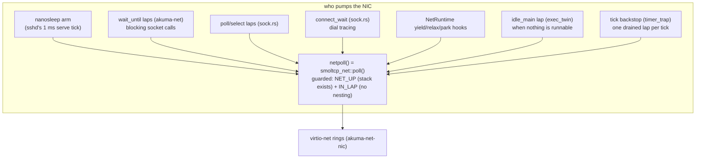

# Devices — COM1, virtio-mmio, LAPIC/PIT, virtio-net, RDRAND

**Stability: C** (the net path is the ladder's active edge).

No PCI walk: the machine is Firecracker-style virtio-mmio, announced by the
VMM in the PVH handoff and read by
[`crates/akuma-ryzen-amd64`](../../../crates/akuma-ryzen-amd64). Every device
register file is mapped into the device window (`DEVMAP_BASE + pa`,
device-uncached) by `map_device`; the virtio slot geometry goes to
`akuma_primitives::addr::set_virtio_window`.

## Console — COM1

[`crates/akuma-comconsole`](../../../crates/akuma-comconsole), minimal. It is
the first thing up and the thing everything else reports through (including
every shared crate, via `akuma_primitives::console::set_print_hook`). It is
**write-only**: there is no input path — an unbound fd 0 reads EOF, and
`CloseChildStdin` is a no-op success for the same reason. The banner is
`src/banner.txt`, included verbatim, printed at the init-spawn point where the
full kernel prints its own.

Console output goes through `safe_print!`/`console::puts` — no heap allocation
on any path that ends at the console (the repo-wide rule; the console is what
survives when the allocator is what broke).

## virtio-blk and the ext2 root

[`crates/akuma-virtio`](../../../crates/akuma-virtio) `block`, polled, device
0 presented to [`crates/akuma-ext2`](../../../crates/akuma-ext2) as `Vda`
(its `BlockDevice`). No `flush`: the cache in front of the media is the
*host's*, which a guest cannot reach past. The root mounts at boot and is
published as `ROOT_FS` for the dispatcher. The mount's clock is `|| 0` — the
honest pre-sync answer; nothing stamps an inode, and `utimensat` validates but
does not stamp ([`syscalls.md`](syscalls.md)).

There is no VFS mount table: one root, resolved directly. Symlinks are the
crate boundary made explicit — `akuma-ext2` resolves components,
`akuma-vfs::path` owns the chain walker (`resolve_symlink_chain`, 8 hops to
ELOOP); `read_link_target` uses `read_symlink`, never `read_file`, because a
fast symlink keeps its target in the inode and has no data blocks. `/bin/sh`
and `/bin/apk` are such links on the serve image.

## LAPIC timer and the PIT

[`crates/akuma-lapic-amd64`](../../../crates/akuma-lapic-amd64) over the
guest's xAPIC page: PICs masked first
([`crates/akuma-port`](../../../crates/akuma-port)), `APIC_GLOBAL_ENABLE` set,
page mapped device-uncached, timer periodic at vector 32, calibrated against
the 8254 PIT. Details and the no-switch rule: [`scheduling.md`](scheduling.md).

## The clock syscalls read (net.rs)

A TSC calibrated once at boot against **PIT channel 2** through ports
0x42/0x43/0x61 — the one device kvm0 emulates well enough for the gate/OUT
handshake. Every step is bounded (`pit_present` probes the port-B gate bit;
the OUT-pin wait has a spin budget): a missing PIT — kvm0's case, there is
no PIT behind port 0x61 — costs one bounded poll, never a hang, and the rate
comes from `net::use_lapic_rate`: `akuma-lapic-amd64::tsc_hz()`, measured by
the LAPIC timer calibration a moment earlier. The fixed 2,500 cycles/µs guess
survives only for a kernel where that has not run. The rule lives in
[`scheduling.md`](scheduling.md) § the wall clock. Timers that drift make TCP
slower, not wrong.

`uptime_us()` = TSC / rate. `epoch=` on the command line anchors the UTC
offset store (`akuma_primitives::clock`) so `CLOCK_REALTIME`/`gettimeofday`
answer wall time; without it they keep the boot-relative/zero answers.

## virtio-net and the pump

[`crates/akuma-net`](../../../crates/akuma-net) (smoltcp, the AF_INET socket
table — no `unsafe`) over
[`crates/akuma-net-nic`](../../../crates/akuma-net-nic) (the virtio-net device
and its DMA arenas — every `unsafe` in networking). `src/net.rs` supplies the
twelve `NetRuntime` function pointers: the TSC clock, the RDRAND RNG, and the
halting answers a one-core, no-NIC-interrupt target makes of the park/wake
hooks — each written out with its reason, the same collapses amd64 makes.

The guest has no IOAPIC and kvm0 never raises the NIC's interrupt line:
**frames arrive only when somebody calls `netpoll`.** Every path a task can
block on pumps it — the nanosleep arm is what keeps TCP alive while sshd
idles. Two non-task pumps close the holes a taskless or spinning guest leaves:
the **idle lap** (an all-parked system used to leave the NIC unposted and the
relay deaf) and the **tick backstop** (a ring-3 spinner the switch gate must
not preempt used to silence the stack for seconds — one drained lap per tick
caps the window at ~10 ms; [`scheduling.md`](scheduling.md)).

**The wait loops halt.** Every wait path (`sleep_until`, `park_until`,
`blocking_relax`, `yield_now`, the DHCP wait, `connect_wait`, and the idle
lap) ends its lap in `net::wait_lap` — `sti; hlt; cli`: IF open for exactly
one `hlt`, the 100 Hz tick always wakes it. The relay thread shares this
vCPU's one pinned host core, and only a halted vCPU hands that core back; a
pause-spinning guest pegs the core and starves the relay it is waiting on
(boot ph-6's P3 stall: frozen `gw_frames`/`rx_starved` behind `hlt=0` with
the guest core at 100%). The one bare-`pause` survivor is deliberate: the
PIT calibration gate poll, where an `hlt` would skew the TSC window being
measured. Nothing pumps while a spawned child runs to completion inside its
SPAWN syscall; that is accepted (the child model), not hidden —
[`processes.md`](processes.md).

DHCP is waited on at boot (10 s, pumping); a guest with no lease still boots —
sshd binds and never answers, a legible failure rather than a hang. Outbound
TCP leaves through the gateway's `vm_outbound` relay: the guest dials the
address it is given and the host makes the real connection.

## Randomness

`getrandom(2)` and TCP initial sequence numbers come from `net::rng_fill`:
RDRAND (feature-checked by CPUID leaf 1 ECX.30 — executing it without the
feature is `#UD`), ten retries per word (Intel's recommendation), and a
counter+TSC SplitMix64 fallback that the boot console names as stated-weak.
The fallback keeps ISNs from repeating every boot; it is **not** a
cryptographic source.

## Background

`docs/archive/MINIMAL_SELF_HOSTING_EXPERIMENT_AGENT_LOG.md` (stage 4 net
bring-up, the Q5 wedge), `docs/reference/subsystems/networking.md` (the full
kernel's stack this is a guest-shaped slice of),
`docs/archive/AKUMA_AMD64_DNS_CONNECTED_UDP.md` (the getsockname/getpeername
lessons).
