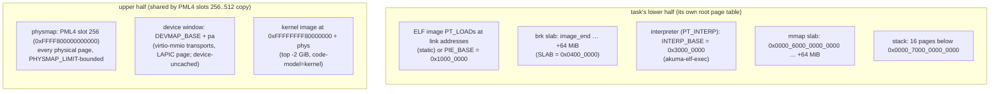

# Memory — address map, slabs, and the user-pointer rule

**Stability: C**.

## The address map

Canonical mermaid source: [`../diagrams/memory-map.md`](../diagrams/memory-map.md).

- Each task's root is a fresh zeroed PML4 whose **upper half is copied from
  the live kernel CR3** (slots 256–511 — one copy shares the physmap, the
  device window and the kernel image) and whose lower half holds only the
  task. The kernel's own root additionally keeps the boot identity map
  ([`boot.md`](boot.md) § identity map).
- Loading is **eager**: every `PT_LOAD` gets fresh zeroed frames mapped at its
  link address, the file bytes copied through the physmap; `.bss` is the
  zeroed tail. The ELF slicing is [`crates/akuma-ring3-amd64`](../../../crates/akuma-ring3-amd64)
  (`Image::parse`); the PT_INTERP *decision* is
  [`crates/akuma-elf-exec`](../../../crates/akuma-elf-exec) — this kernel maps
  the interpreter itself, the crate only decides.
- The initial stack is one full 4 KiB block laid out backwards from
  `USER_STACK_TOP` by `ring3::build_stack`: argc/argv/envp/auxv (14 aux
  entries: `AT_BASE` for the interpreter, `AT_PHDR/PHENT/PHNUM/ENTRY`, uids 0,
  `AT_CLKTCK=100`, `AT_RANDOM=0`). One page, not 512 B — apk's long argv/env
  overran the old block by exactly one pointer word and panicked the kernel
  mid-install.
- `brk` grows by mapping fresh zeroed pages on demand inside its slab;
  shrinking is bookkeeping only (no unmap). Linux's contract is honoured: a
  failed `brk` returns the **old** break.
- `mmap` serves `MAP_ANONYMOUS` (zeroed frames) and `MAP_PRIVATE` of an open
  regular file (zeroed frames filled from the inode at `off` — musl ldso's
  `map_library` shape; no CoW, private because the address space dies with the
  task). `PROT_EXEC` widens the mapping to RWX — there is no W^X policy layer.
  `MAP_FIXED` is honoured only inside the mmap slab; the bump cursor never
  rewinds past it. `mremap` grows by moving to a fresh region (MAYMOVE;
  `MREMAP_FIXED` refused). `munmap`/`mprotect` are accepted no-ops (the slabs
  live as long as the task; nothing enforces per-page protection after
  placement).

## The user-pointer rule

Every user pointer a syscall touches passes `user_ok(va, len)`: `[va, va+len)`
must lie inside one of the task's registered regions (the image segments, the
two 64 MiB slabs, the stack, the interpreter span — 16 slots, registered at
load). Then `copy_from_user`/`copy_to_user` walk the task's **own root page
table** one page at a time and move bytes through the physmap. The region
check is the gate; a page that fails to translate mid-copy is the backstop
(`-EFAULT`), not the mechanism.

This kernel never dereferences a user pointer — there is no `uaccess`
fast path. The console-emit path additionally refuses non-UTF-8 chunks with a
`[tty] write: non-utf8 bytes elided` line rather than silently mangling them.

## fork's memory: eager, flag-faithful copy, no CoW

`fork_share_memory(parent_root)` (main.rs) builds a fork child's address
space — the M2 arm calls it directly, and the real fork reaches the same walk
through the twin's `ExecRuntime::fork_share_memory` hook
([`processes.md`](processes.md)): a fresh root (kernel half shared by the
same PML4 copy), then a
subtree-by-subtree clone of the parent's **user half only**, each leaf a fresh
zeroed frame with the parent's 4 KiB copied in and **the parent PTE's own flag
bits preserved** (RX text stays RX; a RW mapping of text would be NX and the
child would fault on its first instruction). The kernel half is never walked —
its physmap subtree names every physical address the window covers, holes
included. Huge (PS) leaves are refused rather than silently shared.

There is deliberately no copy-on-write: this kernel has no page-fault handler
(a fault kills the task), so there is nothing to break CoW on. Eager copy is
what the ELF loader already does.

## Allocation on syscall paths

The fd and socket arms allocate (`Vec` gathers for writev/sendto, the child
pipe buffer, path `String`s). The caps that keep that bounded: 1 MiB per
`write`/`read` call (`WRITE_LIMIT`), 1 MiB of child stdout (`OUT_CAP`), 128 B
path buffers, 16-entry argv/env read-back, 64 KiB per pipe. Out of memory is
`[OOM]` + halt: there is no pressure ladder on a kernel with no processes to
kill.

## Background

`docs/archive/TAOXICHUAN_STAGE6_PLAN.md` (the 64 MiB slabs),
`docs/archive/TAOXICHUAN_PROCESS_MODEL_PLAN.md` § H3-f (the eager fork),
`docs/archive/MINIMAL_SELF_HOSTING_EXPERIMENT_AGENT_LOG.md` (the stack-block
and double-advance incidents).
