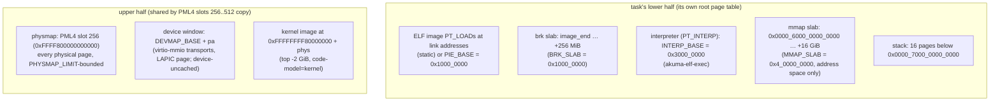

# Memory — address map, slabs, and the user-pointer rule

**Stability: C**.

## The address map

Canonical mermaid source: [`../diagrams/memory-map.md`](../diagrams/memory-map.md).

- Each task's root is a fresh zeroed PML4 whose **upper half is copied from
  the live kernel CR3** (slots 256–511 — one copy shares the physmap, the
  device window and the kernel image) and whose lower half holds only the
  task. The kernel's own root additionally keeps the boot identity map
  ([`boot.md`](boot.md) § identity map).
- Loading is **eager**: every `PT_LOAD` gets fresh zeroed frames mapped at its
  link address, the file bytes copied through the physmap; `.bss` is the
  zeroed tail. The ELF slicing is [`crates/akuma-ring3-amd64`](../../../crates/akuma-ring3-amd64)
  (`Image::parse`); the PT_INTERP *decision* is
  [`crates/akuma-elf-exec`](../../../crates/akuma-elf-exec) — this kernel maps
  the interpreter itself, the crate only decides.
- The initial stack is one full 4 KiB block laid out backwards from
  `USER_STACK_TOP` by `ring3::build_stack`: argc/argv/envp/auxv (14 aux
  entries: `AT_BASE` for the interpreter, `AT_PHDR/PHENT/PHNUM/ENTRY`, uids 0,
  `AT_CLKTCK=100`, `AT_RANDOM=0`). One page, not 512 B — apk's long argv/env
  overran the old block by exactly one pointer word and panicked the kernel
  mid-install.
- `brk` grows by mapping fresh zeroed pages on demand inside its slab;
  shrinking is bookkeeping only (no unmap). Linux's contract is honoured: a
  failed `brk` returns the **old** break.
- `mmap` serves `MAP_ANONYMOUS` (zeroed frames) and `MAP_PRIVATE` of an open
  regular file (zeroed frames filled from the inode at `off` — musl ldso's
  `map_library` shape; no CoW, private because the address space dies with the
  task). `W+X` is refused at `mmap` too: the W^X decision is
  [`crates/akuma-syscalls-mem`](../../../crates/akuma-syscalls-mem) `wx::check_prot`,
  called at the top of both the `mmap` and `mprotect` arms (`wx=0` turns it off).
  The slab is 16 GiB of *reserved address space* (a page costs memory when mapped, not when reserved); at 1 GiB one `rustc` ran out of it — it maps a 311 MB `librustc_driver` and a ~17 MB stack per codegen thread — and musl reported the failed stack `mmap` as `EAGAIN` ("failed to spawn work thread"). Memory is the next wall: the fill is still eager (see `gaps.md`).
  `MAP_FIXED` is honoured only inside the mmap slab; the bump cursor never
  rewinds past it. `mremap` grows by moving to a fresh region (MAYMOVE;
  `MREMAP_FIXED` refused). `munmap` returns address space (hole table); `mprotect`
  re-maps the PTEs (`PROT_NONE` stays a no-op) under the W^X rule of
  `docs/archive/TAOXICHUAN_WX_POLICY.md`: `W+X` is refused and `PROT_EXEC` is
  refused on a page written since it was mapped (`EACCES`; `wx=0` turns it off).

## The user-pointer rule

Every user pointer a syscall touches passes `user_ok(va, len)`: `[va, va+len)`
must lie inside one of the task's registered regions (the image segments, the
two 64 MiB slabs, the stack, the interpreter span — 16 slots, registered at
load). Then `copy_from_user`/`copy_to_user` walk the task's **own root page
table** one page at a time and move bytes through the physmap. The region
check is the gate; a page that fails to translate mid-copy is the backstop
(`-EFAULT`), not the mechanism.

This kernel never dereferences a user pointer — there is no `uaccess`
fast path. The console-emit path additionally refuses non-UTF-8 chunks with a
`[tty] write: non-utf8 bytes elided` line rather than silently mangling them.

## fork's memory: copy-on-write

`fork_share_memory(parent_root)` (main.rs) builds a fork child's address
space — the M2 arm calls it directly, and the real fork reaches the same walk
through the twin's `ExecRuntime::fork_share_memory` hook
([`processes.md`](processes.md)) via `clone_user_half`: a fresh root (kernel
half shared by the same PML4 copy), then a subtree-by-subtree clone of the
parent's **user half only**. The page tables are copied; the **leaf frames are
shared**:

- every present 4 KiB leaf takes one `cow_ref_inc` (the first share inserts 2:
  parent + child); the kernel half is never walked. The counts live in
  [`crates/akuma-pmm`](../../../crates/akuma-pmm) `cow_table::CowTable` — a fixed
  array of 4096-entry chunks (one per 16 MiB of physical space, allocated on the
  first share in its range), so a 100k-page fork costs no per-frame allocation
  (it was a `BTreeMap`, one heap node per shared frame);
- a **writable** leaf is demoted to read-only in *both* tables and marked with
  PTE bit 9 (`PTE_COW`, an MMU-ignored AVL bit); the parent's translation is
  `invlpg`'d, because a stale writable entry would write into the shared frame
  with no fault. A read-only leaf (text, `.rodata`, `mprotect(READ)`) is shared
  with its flags verbatim and **no** marker, so a write to it is still a kill;
- a writable `MAP_SHARED` file mapping (`t.shared`) is the exception: those
  pages are copied eagerly, the per-process-copy-plus-writeback model they run
  under;
- huge (PS) leaves are refused. A refused or failed fork releases what it had
  built through `free_page`, so it leaks nothing.

**One break path**, `cow_resolve(root, va)`: re-read the live PTE, ask
`akuma_cow::decide` (`pte_writable` → `Retry`; unmarked → `Fault`; share count
≤ 1 → `TakeInPlace`; else `Copy`), carry it out, `invlpg`. Three callers:

- `fault_trap`, for a ring-3 fault with error code present+write+user (stack
  growth is tried first; only `Fault` falls through to the kill);
- `copy_to_user` — the kernel writes user pages through the physmap, which
  never faults, so it calls `cow_prepare_write` on each destination page first
  and answers `EFAULT` (as Linux does for a kernel write to a page the user
  could not write) when the break is needed and fails, or when the page is
  read-only and shared but *unmarked* (shared text, or `mprotect(PROT_READ)`
  after a fork) — an unshared read-only page stays kernel-writable;
- `mprotect` to a writable mapping calls `cow_privatize`: a frame held by two
  spaces becomes private before the PTE is re-mapped RW (marked or not — a
  shared text page is unmarked).

Teardown needed no new code: every release site (`free_user_root`,
`release_pages`, the exec/reap parking) goes through `akuma_pmm::free_page`,
which only drops a count while the frame is shared. The gate is
`scripts/kvm/goose/cow_leak_gate.py`: an idle machine's free-page count after
N fork/exec/exit rounds must equal the baseline **exactly**, with
`cow_ref_count() == 0`. The reap lines (`trace-err`) print `cowrefs=` and
`cow=(shared, copied, taken, retried)`.

Known limits: a shared read-only page stays read-only to ring 3 (a write
kills, by design — there is no user-text self-modification). Incident, plan and
measurements: `docs/archive/TAOXICHUAN_COW_FORK.md`; the two `cow_prepare_write`
holes closed on 2026-10-30 are §9 of
`docs/archive/TAOXICHUAN_BUGS_FOUND_2026_10_30.md`.

## Allocation on syscall paths

The fd and socket arms allocate (`Vec` gathers for writev/sendto, the child
pipe buffer, path `String`s). The caps that keep that bounded: 1 MiB per
`write`/`read` call (`WRITE_LIMIT`), 1 MiB of child stdout (`OUT_CAP`), 128 B
path buffers, 64 KiB per pipe, and the execve argument block: 448 `argv` /
256 `envp` entries, 32 KiB per string, `argv + envp <= 512` and a total-bytes
guard — every overrun answers `E2BIG`, never `EFAULT` (2026-10-30; one heavy
`rustc` call carries 344 arguments and a 5,192-byte argument). Out of memory is
`[OOM]` + halt: there is no pressure ladder on a kernel with no processes to
kill.

## Background

`docs/archive/TAOXICHUAN_STAGE6_PLAN.md` (the 64 MiB slabs),
`docs/archive/TAOXICHUAN_PROCESS_MODEL_PLAN.md` § H3-f (the eager fork),
`docs/archive/MINIMAL_SELF_HOSTING_EXPERIMENT_AGENT_LOG.md` (the stack-block
and double-advance incidents).
