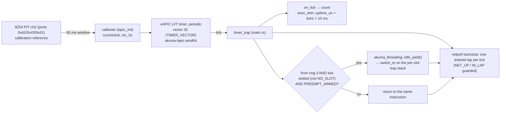
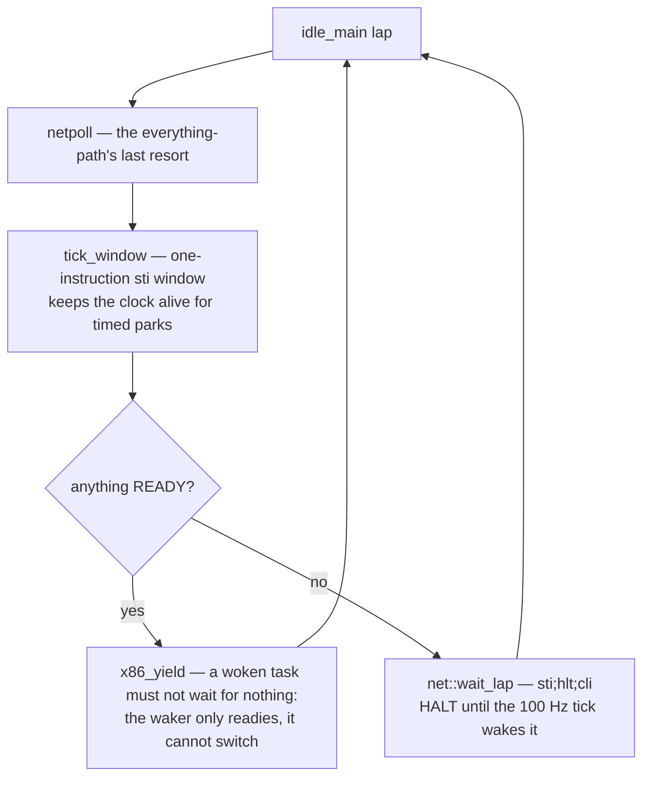

# Scheduling — the tick, the switch, and the idle halt

**Stability: C** (slice 3 landed the switch and preemption recently; verify
against a current boot).

## The tick and its two gates

Canonical mermaid source: [`../diagrams/scheduling.md`](../diagrams/scheduling.md).

- The tick source is the extracted crate
  [`crates/akuma-lapic-amd64`](../../../crates/akuma-lapic-amd64): `lapic_init`
  (main.rs) masks the legacy PICs
  ([`crates/akuma-port`](../../../crates/akuma-port)), sets
  `IA32_APIC_BASE.APIC_GLOBAL_ENABLE`, maps the LAPIC page device-uncached,
  and hands the crate the window — which software-enables the LAPIC,
  calibrates against the 8254 PIT and arms the periodic timer at vector 32.
- **The tick may switch** (slice 3): a tick that interrupted ring 3 runs the
  same `x86_yield` the park loop and the idle lap run, on this handler's own
  per-slot trap stack (`arm_trap_stack` — a preempting switch leaves the
  interrupted frame on the interrupted task's stack, so the next ring-3 trap
  on any task must not land there). Two gates, both paid for:
  - **The user-era gate** (`PREEMPT_ARMED`, set at the first SPAWN crossing):
    before it the machine is kernel-only and a switching tick died inside net
    calibrate — no legal switch target exists.
  - **The slotted-current gate**: after an exec'd shell's exit tears its slot
    down, a ring-3 tick can fire with `NO_SLOT` current; the crate's switch
    engine indexes by current tid, so a tick with no live slot must not
    switch. A permanent NO_SLOT ring-3 resident (the boot image's init) is
    present in every gate window and is exactly what this gate protects — and
    what the netpoll backstop below exists for.
  - Kernel paths run IF-masked, so ring 0 is never switched here; a ring-0
    tick lands only in the idle window, which self-yields.
- **The netpoll backstop**: one drained `netpoll` lap per tick, called after
  the switch gate. Every other pump is task-context (sshd's serve-loop sleep,
  the DHCP wait, the NetRuntime hooks), so a ring-3 spinner the gate must not
  switch used to silence the stack for seconds (boot ph-5's P2: ~10 s of
  frozen `gw_frames_from_guest` until the client's handshake watchdog fired).
  One lap per tick caps any such window at ~10 ms — the by-construction
  servicing the other kernels get from their interrupt face. `netpoll` guards
  itself: `NET_UP` (set after `akuma_net::init` succeeds — a tick can fire
  before the stack exists) and `IN_LAP` (tick-context and task-context laps
  never nest).
- The syscall-answer clock is a **second** source by design: `net::uptime_us`
  (PIT-calibrated TSC, [`devices.md`](devices.md) § clock) serves
  `clock_gettime`/`nanosleep`/`poll` laps; the twin's tables get the tick
  clock so the scheduler and `akuma-exec` cannot disagree (amd64's one-clock
  rule, verbatim).

## switch_to — the machine effects of a park-point switch

`exec_twin::switch_to(from, to)` is real (slice 3). The crate
(`x86_yield_now`/`x86_switch_context`) has already named `next` current and
moves the stacks itself; the twin adds, in order:

1. the incoming task's **syscall band** (`sched_kstack_top(to)` →
   `set_syscall_stack_top`),
2. `TASK_SLOT = sched_task_slot_of(to)` — the dispatcher's `task()` must name
   the incoming task's record, or a resumed task runs its syscalls against the
   *previous* task's fd table and root (the exec'd shell's writev loop reading
   zeros out of the wrong address space, boot pg-2). The shell is threading
   tid `shell_tid()` — its spawn-ring slot, written at every SPAWN crossing
   (it was once hardcoded 0, which only held for a boot's first login spawn);
   real children are task record `tid + 1`. The idle thread (tid ≥ NSLOTS) is
   excluded — kernel-only, leaves the previous task's slot armed, exactly as
   it leaves CR3,
3. the incoming task's **trap stack** (`arm_trap_stack`),
4. **CR3** (`sched_root_of(to)`; 0 = leave it alone — the idle thread runs on
   the kernel root),
5. **IA32_FS_BASE** from the incoming slot's shadow ([`processes.md`](processes.md)
   § the fs discipline).

`from` needs nothing: the crate saves its context.

## The idle thread halts

`IDLE_TID = NSLOTS` (outside the ring; its CR3 is the kernel's, its stack a
leaked 16 KiB), seeded READY at registration. `idle_main`:

When nothing is runnable the idle thread **halts** — the one idle-contract
clause the other kernels all have and this kernel lacked. The relay thread
shares this vCPU's **one pinned host core** (`docs/archive/KVM_RELAY_SYN_STALL.md`),
and only a halted vCPU hands that core back: a spinning idle lap's netpoll
cannot receive what the starved relay cannot run to deliver (pi's HI1).
`wait_lap` opens IF for exactly one `hlt` instruction, so the tick always
wakes it; the yield check stays after the lap.

## The wait loops halt too

Every guest wait path — `sleep_until`, `park_until`, `blocking_relax`,
`yield_now`, the DHCP wait, `connect_wait` — laps through `net::wait_lap`
instead of a bare `pause`/`spin_loop` (session ph: boot ph-6's P3 stall was
~10 s of frozen relay counters behind `hlt=0` with the host's guest core at
100% — the guest's stack was provably pumped, the *host core* was the
constraint). The one exception is deliberate: the calibrator's PIT gate poll
keeps the bare pause, because an `hlt` would skew the TSC window it measures.

## The hooks

`exec_twin` registers `X86ArchHooks`; all slice-2/3 arms are real now:

| hook | today |
|---|---|
| `switch_to` | **real** — the five machine effects above |
| `current_slot` / `set_current_slot` | one-core static; the SMP slice puts `%gs` behind the body, never the callers |
| `idle_slot` | `IDLE_TID` (= `NSLOTS`) |
| `can_run` | any ring slot, the boot task, or the idle thread (nothing pins) |
| `allow_tick` / `tick_window` | the one-instruction `sti` window — the frozen-clock escape and the idle loop's clock feeder |
| `prepare_task_slot` / `write_user_context` / `read_user_context` | per-slot leaked stacks (64 KiB kernel + 32 KiB trap, made once, reused on recycle) and the ring-3 register capture; the fork capture reads the **live** fs MSR |
| `transfer_lock_depth` | no-op: no BKL is taken (one core, no BKL compiled in) |

`ExecConfig`/`ThreadConfig` carry this kernel's truths (stack sizes = the 64
KiB syscall band, `max_threads` = the ring width + idle, canaries off with the
boot-stack bounds 0).

## Background

`docs/archive/TAOXICHUAN_M4_SCHED_LITE_PLAN.md` (slices, the `%gs` decision),
`docs/archive/TAOXICHUAN_M4_SLICE3_PE_PLAN.md` …
`docs/archive/TAOXICHUAN_M4_SLICE3_PH_RESULT.md` (the switch, the gates, the
backstop, the halting waits),
`docs/archive/KVM_RELAY_SYN_STALL.md` (the one-pinned-core constraint),
`docs/archive/TAOXICHUAN_M4_SLICE3_VERDICT_PLAN.md`.
