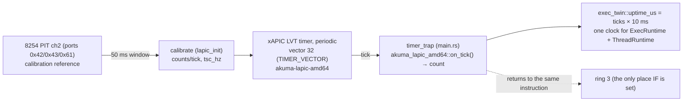

# Scheduling — the tick, and what is deliberately not here yet

**Stability: C** (preemption is the M4 slice-3 work in flight; this doc states
what is true now).

## Today: one core, IF clear in the kernel, a tick that only counts

Canonical mermaid source: [`../diagrams/scheduling.md`](../diagrams/scheduling.md).

- The tick source is the extracted crate
  [`crates/akuma-lapic-amd64`](../../../crates/akuma-lapic-amd64): `lapic_init`
  (main.rs) masks the legacy PICs
  ([`crates/akuma-port`](../../../crates/akuma-port)), sets
  `IA32_APIC_BASE.APIC_GLOBAL_ENABLE`, maps the LAPIC page device-uncached,
  and hands the crate the window — which software-enables the LAPIC,
  calibrates against the 8254 PIT and arms the periodic timer at vector 32.
- **No task switch on the tick.** Every kernel path runs with interrupts
  masked (`syscall` masks on entry; nothing unmasks), so a tick can only fire
  in ring 3, and `timer_trap` returns to the same instruction after counting.
  The count doubles as the twin's uptime clock.
- The syscall-answer clock is a **second** source by design: `net::uptime_us`
  (PIT-calibrated TSC, [`devices.md`](devices.md) § clock) serves
  `clock_gettime`/`nanosleep`/`poll` laps, because the syscalls predate the
  LAPIC and their deadlines want sub-tick resolution. The twin's tables get
  the tick clock so the scheduler-to-be and `akuma-exec` cannot disagree
  (amd64's one-clock rule, verbatim).

## The hooks that exist for the switch that does not

`exec_twin` registers `X86ArchHooks` so the seam exists before its first
customer (the plan's slice order):

| hook | today |
|---|---|
| `switch_to` | **panics** naming slice 3 — loud rather than silently wrong; nothing can reach it (no threads, no pick loop) |
| `current_slot` / `set_current_slot` | real, one-core static; the SMP slice puts `%gs` behind the body, never the callers |
| `idle_slot` | `NO_SLOT` (the boot task) |
| `can_run` | any ring slot or the boot task (nothing pins) |
| `allow_tick` | real: a one-instruction `sti; nop; cli` window (the frozen-clock escape) — nothing calls it until blocking syscalls arrive |
| `prepare_task_slot` / `write_user_context` / `read_user_context` | real, over the per-slot table: leaked 64 KiB kernel + 32 KiB trap stacks per slot (made once, reused on recycle), the ring-3 register capture |
| `transfer_lock_depth` | no-op: no BKL is taken (one core, no threads) |

`ExecConfig`/`ThreadConfig` carry this kernel's truths (stack sizes = the 64
KiB syscall band, `max_threads` = the spawn ring's width, canaries off with
the boot-stack bounds 0) so the day a shared consumer reads them, the values
are already right.

## What lands with fork_process (slice 3)

The switch itself, parked parents, and the pick loop — at which point the tick
stops being count-only and `switch_to` stops panicking. Until then the M2
blocking fork ([`processes.md`](processes.md)) is the whole concurrency story,
and it is marked THROWAWAY in the source for exactly this reason.

## Background

`docs/archive/TAOXICHUAN_M4_SCHED_LITE_PLAN.md` (slices 1–5, the `%gs`
decision), `docs/archive/TAOXICHUAN_M4_SLICE3_PE..PH_*` (the slice-3
progression and its open items).
